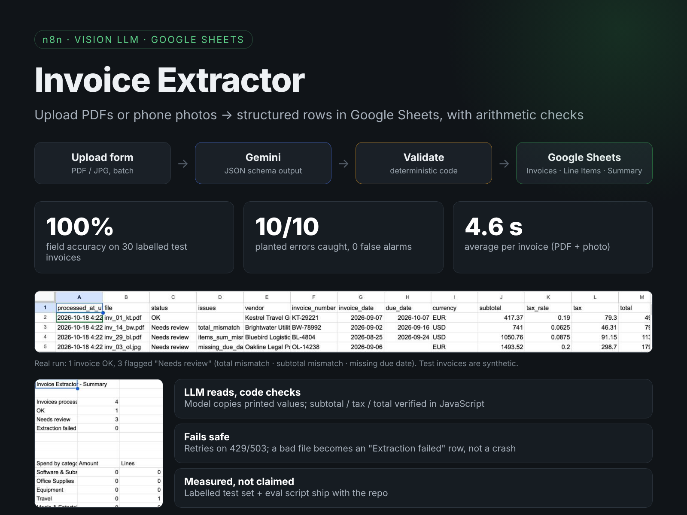
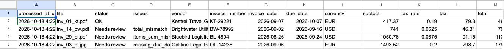

# Invoice Extractor (n8n + Gemini)



Upload invoice PDFs or phone photos through a web form. A vision LLM reads each document into a fixed JSON schema, deterministic code checks the arithmetic, and the results go into Google Sheets. Invoices that fail a check are marked **Needs review**.

```
Upload form (PDF / JPG / PNG, several at once)
  → Build Gemini request   file → base64 + prompt + JSON schema
  → Gemini extract         structured output (responseSchema), temperature 0, retries
  → Parse + validate       arithmetic checks in plain JavaScript, not the LLM
  ├→ Sheets: Invoices      one row per invoice, with status + issues
  └→ Sheets: Line Items    one row per line, with a spend category
```

## Results

Measured on 30 labelled test invoices (20 PDF, 10 phone photos, 3 layouts, 4 currencies). 9 of them contain 10 planted issues (wrong subtotal, wrong total, missing due date).

<!-- RESULTS:START -->
Model: `gemini-3.5-flash-lite`

| Metric | Result |
|---|---|
| Field accuracy (header + line items) | **100.0%** |
| Invoices with every field correct | 30/30 (PDF 20/20, photo 10/10) |
| Planted errors caught | **10/10**, 0 false alarms |
| Spend category (LLM-assigned) | 96.7% |
| Avg latency | 4.6 s / invoice |

> These are synthetic, clean invoices. Real-world scans (skewed, stamped, handwritten) will score lower. The point of the eval is that accuracy is *measured*, and that any prompt or model change can be re-scored in one command.

Full per-field breakdown and every miss: [results/report.md](results/report.md)
<!-- RESULTS:END -->

## Live run

Four test invoices uploaded through the form. The three with planted problems are flagged in the sheet:



## Design decisions

| Problem | Approach |
|---|---|
| LLMs "helpfully" fix wrong totals | The prompt says to copy printed values exactly. Checking happens afterwards, in code. |
| LLM arithmetic is unreliable | `validate()` is deterministic code: line items vs subtotal, items + tax vs total, qty × price vs amount, missing due date or required fields |
| One wrong subtotal raising two alerts | The total is checked against the line-item sum, so a wrong subtotal is reported once (`items_sum_mismatch`), not twice |
| Free-form output breaking downstream steps | Gemini `responseSchema` (JSON mode) with a fixed category enum |
| Prompt in production drifting from the tested prompt | `extractor/spec.py` is the single source of truth. `build_workflow.py` generates the n8n workflow from it, and `eval.py` tests the same prompt and rules. |
| API hiccups (429/503) | Retry with backoff. A failed document becomes an `Extraction failed` row instead of stopping the batch. |
| Proving accuracy rather than claiming it | A labelled synthetic test set (`testdata/`) plus a field-by-field scorer |

## Files

| Path | What |
|---|---|
| `workflow.json` | Import into n8n (Workflows → Import from File) |
| `sheets_template.xlsx` | Upload to Google Drive → open with Google Sheets. Contains the Invoices, Line Items and Summary tabs. |
| `eval.py` | Accuracy benchmark, standard library only |
| `extractor/spec.py` | Prompt, schema, validation rules (Python + identical JS) |
| `extractor/build_workflow.py` | Regenerates `workflow.json` from the spec |
| `testdata/` | 30 fictional invoices + `ground_truth.json` + the generator script |

## Setup

1. **Gemini API key**: create one at [Google AI Studio](https://aistudio.google.com/apikey). The default model, `gemini-3.5-flash-lite`, is on the free tier.
2. **n8n**: import `workflow.json`. In **Gemini extract**, create a *Header Auth* credential with name `x-goog-api-key` and your key as the value.
3. **Google Sheets**: upload `sheets_template.xlsx` to Drive and open it with Google Sheets. In both Sheets nodes, connect a Google Sheets OAuth2 credential and paste the sheet URL.
4. Open the **Upload form** test URL, upload a few files from `testdata/invoices/`, and watch the rows appear.

Run the benchmark:

```bash
export GEMINI_API_KEY=...        # never commit this
python eval.py                   # extracts all 30 (cached in results/predictions/), then scores
python eval.py --rescore         # re-score cached predictions without API calls
python eval.py --mock            # self-test the scorer, no key needed
```

## Extending it

- Trigger from a Gmail label or a Google Drive folder instead of the form
- Push "Needs review" rows to Slack or Telegram for approval
- Map vendors to accounting codes and export to QuickBooks or Xero
- Add local formats (Taiwan e-invoices / China VAT fapiao) with their own validation rules

---

**中文簡介：** 上傳發票 PDF 或手機翻拍照片後，Gemini 視覺模型會依固定格式擷取欄位，再由程式（不是 AI）檢查金額是否算錯、欄位有沒有缺漏，最後寫入 Google Sheets；有問題的發票標記為「Needs review」。專案附 30 張標註好的測試發票和評估腳本，可以實際量測準確率。
